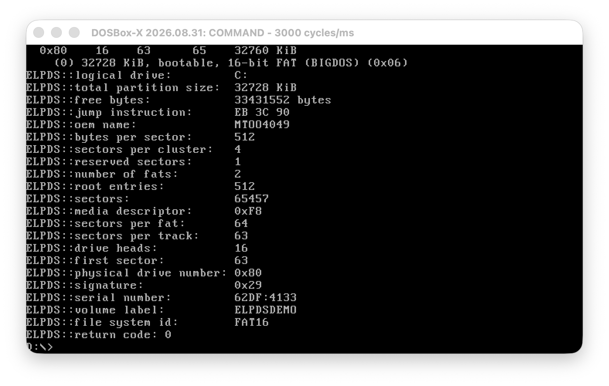

# ELPDS

ELPDS 1.0 (Enhanced Logical & Physical Drive Status) is a DOS hard-drive inspection utility written by Daniel Doubrovkine in 1995.



It reports BIOS disk geometry and partition-table entries, then reads a selected logical drive's FAT boot sector to display its filesystem parameters, volume label, serial number, capacity, and free space. Its original purpose was checking whether a partition exists and is formatted, with return codes usable from batch files. I think I was just trying to learn about the underlying partition mechanics.

## Original

`original/ELPDS.CPP` and `original/ELPDS.EXE` are preserved unchanged. The executable is a compressed 16-bit DOS program; the source uses Borland-style DOS APIs and inline x86 assembly.

The program reads disks but does not write to them. It targets BIOS CHS addressing and FAT12/FAT16, not modern GPT partitions, FAT32, or SMART health reporting.

The original help credits substantial code from FIPS and contains a historical noncommercial distribution notice. These archival notices are preserved unchanged.

### FIPS

FIPS stands for *First nondestructive Interactive Partition Splitting program*. It was a DOS utility for splitting an existing FAT partition without deleting its files, often used to make room for Linux alongside DOS or Windows.

FIPS was written by Arno Schaefer. An [archived FIPS source file](https://web.mit.edu/ghudson/sipb/fips/main.cc) credits him, copyright 1993, and specifies GPL version 2 or later. ELPDS's original help credits him as "Mr. Schaeffer" (misspelled).

Archived FIPS source files at MIT: [disk_io.cc](https://web.mit.edu/ghudson/sipb/fips/disk_io.cc), [logdr_st.h](https://web.mit.edu/ghudson/sipb/fips/logdr_st.h), [logdr_st.cc](https://web.mit.edu/ghudson/sipb/fips/logdr_st.cc), [hdstruct.h](https://web.mit.edu/ghudson/sipb/fips/hdstruct.h), and [hdstruct.cc](https://web.mit.edu/ghudson/sipb/fips/hdstruct.cc).

### Borrowed code

Comparison with that archive identifies these copied or adapted sections in `original/ELPDS.CPP`:

| ELPDS lines | FIPS source | Evidence |
| --- | --- | --- |
| 9-16 | `disk_io.cc` | Same BIOS interrupt and operation constants, including unused write and verify constants. |
| 34-54 | `logdr_st.h`, `Bios_parameter_block` | Same field order, names, and distinctive comments, including "usually 512 for HDs (?)" and "dto."; ELPDS splits the serial number into two fields. |
| 229-251 | `logdr_st.cc`, `Bios_parameter_block::get` | Nearly verbatim boot-sector extraction statements, offsets, and string termination. ELPDS splits the serial-number decoding and reads into a signed `char` buffer instead of FIPS's `byte` buffer. |
| 301-315 | `hdstruct.h`, `Partition_info` | Same partition-field declarations and multiline comments/formulas, with an extra `bootable_txt` variable in ELPDS. |
| 357-376 | `disk_io.cc`, `get_disk_type` and `get_no_of_drives` | Function bodies match apart from comments and whitespace. |
| 405-418 | `disk_io.cc`, `Physical_drive::get_geometry` and `physical_sector_no` | Geometry decoding and logical-sector-to-CHS formulas adapted from two FIPS routines, replacing class members with globals and fixing the logical sector to zero. |

ELPDS's MBR-entry loop also resembles `hdstruct.cc`'s `Partition_table::get`, but uses different buffer indexing and rearranges the sector-count expression; this is weaker evidence than the near-verbatim blocks above.

The comparison establishes substantial borrowing of FIPS's low-level disk inspection code, not its partition-splitting implementation. ELPDS adds its own command-line interface, status display, delay/pause behavior, free-space reporting, and DOS error handling.

## Ported

`ported/` contains an Open Watcom adaptation and a rebuilt `ELPDS.EXE`. It is still a 16-bit DOS program, not a native macOS application.

The adaptation replaces Borland-specific APIs with Open Watcom DOS/BIOS calls, fixes unsigned boot-sector decoding and the mislabeled FAT16 partition type, and reports failed reads explicitly. It removes the screen clearing, interactive help, and five-second delay so output can be redirected. Quiet mode still reports errors to stderr. Only the four primary MBR entries are inspected; extended-partition chains are not traversed.

### Build

Install [DOSBox-X](https://dosbox-x.com/). On macOS:

```sh
brew install dosbox-x mtools
```

Download the DOS C/C++ installer from the [Open Watcom releases](https://github.com/open-watcom/open-watcom-v2/releases). The `open-watcom-2_0-c-dos.exe` installer is also a ZIP archive: extract it into a directory outside this repository using `unzip`. It contains `binw/`, `h/`, and `lib286/`.

From the repository root:

```sh
WATCOM=/path/to/watcom sh ported/build.sh
```

The script runs the DOS compiler inside DOSBox-X and creates `ported/ELPDS.EXE`. Alternatively, in DOS with Open Watcom configured, run `ported/BUILD.BAT`. The port is built for an 8086 CPU using the small memory model.

### Run

```sh
sh ported/run.sh
```

This requires Python 3 and `mformat` from mtools. It creates a disposable approximately 32 MiB FAT16 hard-disk image, mounts it as `C:` in DOSBox-X, mounts `ported/` as `D:`, and runs `ELPDS C:`. No proprietary DOS installation is needed: this uses DOSBox-X's built-in DOS.

The demo image has a partition table but no boot loader and is not bootable. Its partition entry has the active flag set to demonstrate the original program's "bootable" status field; that field does not prove the disk can boot.

Every invocation of `run.sh` recreates `ported/demo.img`, discarding changes to that demo disk. It never mounts a host physical disk. A directory mounted as `C:` is not an equivalent test: the program needs sector-level access to an image-backed drive.

The verified demo reports one BIOS hard disk with 16 heads, 63 sectors per track, and 65 cylinders, a FAT16 partition starting at sector 63, the volume label `ELPDSDEMO`, and return code 0.

## Usage

```text
ELPDS C:
ELPDS C: -d
ELPDS C: -m
```

`-d` skips the detailed boot-sector display and its delay. `-m` suppresses most messages. `-?` displays help when supplied after the drive argument.

In the port, there is no delay, and `ELPDS -?` also works. Return codes are 0 for success, 20 for invalid arguments or an unavailable/unsupported logical drive, and 21 for physical BIOS/device errors.

## License

ELPDS is available under the GNU General Public License, version 2 or (at your option) any later version ([GPL-2.0-or-later](LICENSE)).

Copyright (C) 1993 Arno Schaefer, for the incorporated FIPS code. Copyright (C) 1995, 2026 Daniel Doubrovkine, for ELPDS and its DOS adaptation.

The historical noncommercial notice in `original/ELPDS.CPP` is preserved as an archival artifact, not an additional restriction on this GPL release. It does not override the incorporated FIPS code's GPL terms.

When distributing an executable, provide its corresponding source and build instructions under the GPL. `ported/ELPDS.EXE` is built from the accompanying `ported/ELPDS.CPP` using `ported/BUILD.BAT`. The recovered `original/ELPDS.EXE` corresponds exactly to `original/ELPDS.CPP` as both were recovered from the same archive.